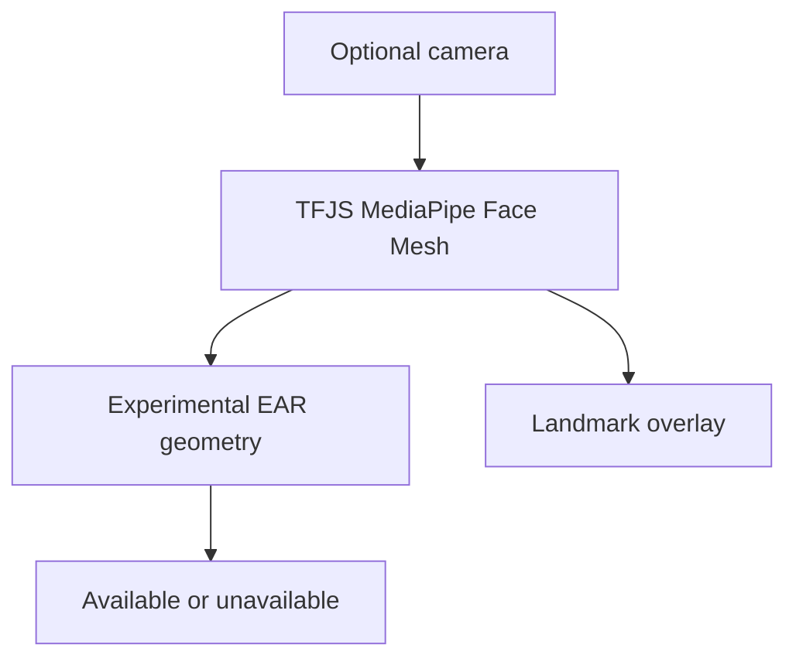

# SCAN Biomedical — Studio Niko Design

**Experimental facial landmark visualization · No physiological measurement**

## État actuel — correction P0

Le [commit source](https://github.com/Nikoju1977/SCAN-BIOMEDICAL/commit/416dce75f69b5d93d1bd49836a6e9f0c1844de4b) retire PPG, BPM, fatigue, compteur de clignements et rapports associés. Le suivi TFJS/MediaPipe et le rapport géométrique EAR restent expérimentaux. Les repères invalides renvoient une absence de résultat. La boucle évite les inférences concurrentes et les résultats de sessions obsolètes.

Aucun usage médical ou de sécurité. Les dépendances et les poids peuvent nécessiter le réseau ; aucune garantie de confidentialité. Qualifier le cycle caméra, l'absence de visage, les coordonnées synthétiques et les erreurs du modèle. Aucun nouveau test d'exécution ou déploiement vérifié.

## English overview

Experimental Face Mesh visualization with a geometric eye aspect ratio. Unqualified pulse and fatigue metrics have been removed. No clinical, safety, runtime or deployment qualification is claimed.

[Notice de droits](LICENSE.md).

## Historique

Les constats antérieurs sont conservés dans l'historique Git du README. Les licences existantes restent inchangées.
