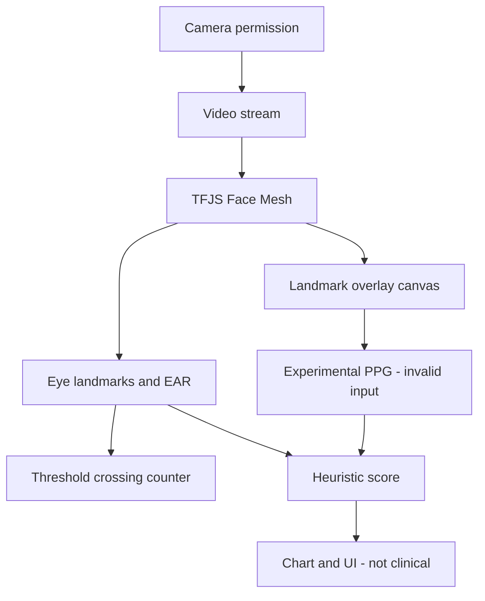

# SCAN Biomedical — Studio Niko Design

**Experimental browser-based facial landmark tracking and visualization of eye-opening signals.**

Un prototype de vision par ordinateur qui explore le suivi facial et des indicateurs géométriques dans le navigateur, sans prétention diagnostique.

    

**STUDIO NIKO DESIGN** · Build smart. Stay lightweight. Create without limits.

[English overview](#english-overview) · [Quickstart](#quickstart--démarrage-rapide) · [Issues](https://github.com/Nikoju1977/SCAN-BIOMEDICAL/issues)

## Sécurité d'usage — priorité de qualification

> **Ne pas utiliser pour mesurer la fréquence cardiaque, diagnostiquer une fatigue, surveiller un patient ou prendre une décision de sécurité.** Le code peut afficher 70 BPM sans signal exploitable. L'indicateur n'est pas une mesure médicale. Cette documentation ne désactive pas les fonctions trompeuses : leur retrait ou neutralisation constitue une correction prioritaire.

| Vérification proposée | Critère attendu avant qualification du prototype visuel |
| --- | --- |
| Géométrie EAR | Avec des coordonnées synthétiques et des distances verticales 2 et 2, horizontale 10, le rapport attendu est 0,2 |
| Repères absents ou dégénérés | Afficher une absence de mesure ; ne pas interpréter un zéro de repli comme un œil fermé |
| Perte du suivi | Invalider les résultats précédents et signaler clairement l'indisponibilité |
| Fréquence cardiaque et fatigue | Supprimer ou désactiver les valeurs non validées ; ne pas afficher un BPM par défaut comme une mesure |
| Caméra | Refus explicite de permission, arrêt des pistes en fin de session |
| Confidentialité | Vérifier les flux réseau et l'absence de conservation ou de transmission inattendue |

Ces critères ne constituent pas un protocole clinique. Aucun sujet humain, test de caméra, audit réseau ou essai clinique n'a été réalisé pour cette mise à jour. Utiliser des coordonnées synthétiques pour les essais géométriques ; ne pas fournir d'images de patients.

**English:** The current PPG and fatigue outputs are invalid for medical or safety use. A default heart rate may be displayed without valid physiological input. Disable misleading metrics before further demonstration. Proposed checks concern synthetic geometry, unavailable tracking, camera shutdown and privacy; they are not clinical validation.

> **Prototype non qualifié.** Inspection statique du code uniquement : aucun nouveau test d'exécution, audit de sécurité, benchmark, test physique, validation industrielle ou clinique n'a été effectué pour cette révision. Utiliser des données synthétiques.

## Pourquoi ce projet ?

Explorer l'inférence visuelle côté client sur du matériel courant, en séparant ce que le détecteur de repères observe de ce que des heuristiques tentent d'en déduire. L'application illustre un pipeline expérimental, pas un instrument biomédical utilisable en clinique.

## Fonctionnalités clés

- 🎥 Acquisition caméra après autorisation et arrêt des pistes lorsque la caméra est désactivée.
- 🧠 Repères faciaux MediaPipe Face Mesh via TensorFlow.js, backend WASM ou WebGL sélectionné.
- 👁️ EAR (Eye Aspect Ratio), compteur de franchissements de seuil de fermeture des yeux.
- 📈 Courbe Chart.js du score heuristique et interface de session bornée à 15 secondes.
- 🧪 Module expérimental PPG et score de fatigue : présents dans le code, non fiables pour une mesure physiologique.

## Architecture & sécurité



### Algorithmes et défauts constatés

- `calculateEAR` : somme de deux distances verticales divisée par deux fois la distance horizontale, à partir de six repères par œil. Le compteur détecte un passage de EAR > 0,2 à EAR < 0,18 ; il ne valide pas un clignement complet.
- `PPGProcessor.analyze` : lit une zone centrale de 20 × 20 pixels du canvas des repères, calcule la moyenne du canal vert et compte les pics. Le canvas est effacé et redessiné avec des points ; le flux vidéo de la peau n'y est pas copié dans la boucle inspectée. Ce n'est donc pas une rPPG physiologique valable.
- L'estimation suppose 30 échantillons/s alors que l'intervalle nominal de la boucle est de 200 ms (bureau) ou 300 ms (mobile), hors délai d'inférence. Le repli initialise 70 BPM et les résultats sont bornés à 45–150 BPM. Ce nombre peut être affiché sans signal valide.
- `computeFatigueScore` : combinaison plafonnée de seuils EAR et BPM ; l'entrée BPM invalide et l'absence de validation clinique rendent le score non interprétable médicalement. Ne pas utiliser pour détecter somnolence, aptitudes, maladies ou risques.

### Dépendances et confidentialité

TensorFlow.js 4.15.0, backend WASM, MediaPipe Face Mesh, face-landmarks-detection 1.0.2, Chart.js 4.4.1 et Google Fonts sont chargés par CDN. Le traitement de la boucle inspectée est local ; cela ne prouve pas l'absence de toute communication réseau des dépendances. Aucune garantie de confidentialité ou de sécurité clinique. Ne pas filmer de tiers ni utiliser des données de santé. Le service worker tente un enregistrement par URL Blob, généralement non pris en charge ; l'installation et le hors-ligne ne sont pas établis. Le nom « QUANTUM AI » est un nom d'interface, pas une implémentation quantique.

## Référentiels et limites de conformité

**Aucun marquage CE, aucune validation clinique, aucune conformité ISO 13485 / IEC 62304 / FDA 21 CFR Part 11 n'est démontrée.** Ces référentiels peuvent devenir pertinents selon l'usage prévu et le cadre réglementaire ; leur applicabilité doit être qualifiée par des personnes compétentes. Le projet ne constitue ni un système de diagnostic ni un dispositif de sécurité. Le guide officiel [FDA Part 11](https://www.fda.gov/regulatory-information/search-fda-guidance-documents/part-11-electronic-records-electronic-signatures-scope-and-application) concerne le périmètre réglementé des enregistrements et signatures électroniques, non une certification automatique de logiciels.

## Quickstart / Démarrage rapide

Lancer `python3 -m http.server 8000`, puis ouvrir http://localhost:8000/. Utiliser une scène d'essai consentie et non sensible, autoriser la caméra uniquement pour l'expérimentation visuelle. Ne pas interpréter les valeurs affichées comme des mesures physiologiques ; désactiver la caméra en fin d'essai. Le chargement des bibliothèques exige le réseau.

## Documentation technique historique

Les informations antérieures ci-dessous sont conservées pour le contexte ; les constats de l'inspection statique et les limites explicites ci-dessus priment sur toute formulation historique trop générale.

**Catégorie :** prototype d'interface biométrique assistée par IA · Studio Niko Design.

## Ce que fait réellement ce dépôt

La page `index.html` porte le titre **« QUANTUM AI by Niko | Agent Biométrique Clinique »**. Elle présente un parcours pour **activer la caméra**, **démarrer une analyse IA**, afficher des **métriques biométriques** et visualiser une **évolution de la fatigue**.

Il s'agit de l'interface biométrique actuellement présente dans le dépôt, **pas d'un logiciel d'analyse histopathologique de biopsies ou de lames microscopiques**. Les anciens textes suggérant un tel périmètre ne reflétaient pas l'interface examinée.

## Démarrage

Depuis la racine du dépôt :

```sh
python3 -m http.server 8000
```

Ouvrir http://localhost:8000/ ; l'accès caméra exige généralement HTTPS ou localhost et l'accord de l'utilisateur. Les bibliothèques externes et les fonctions d'IA peuvent nécessiter une connexion.

## Confidentialité et limites

**Prototype de démonstration non validé cliniquement.** Les métriques présentées par une caméra ne constituent pas des mesures physiologiques calibrées ni un diagnostic de fatigue ou de maladie. Les données vidéo ou images personnelles nécessitent une revue des flux réseau avant utilisation. Ne pas utiliser pour une décision de santé ou de sécurité.

Ce README décrit la structure observable du projet ; il ne certifie **ni les résultats de l'IA, ni la sécurité, ni le fonctionnement sur appareils réels**.

[Voir le catalogue détaillé des projets](https://github.com/Nikoju1977/Nikoju1977/blob/main/PROJECTS.md)

## Roadmap & contribution

Propositions non terminées :

- [ ] Priorité sécurité : supprimer ou désactiver les valeurs BPM/fatigue trompeuses tant qu'un signal valide et un protocole d'évaluation n'existent pas.
- [ ] Si recherche rPPG : définir une vraie région de peau, échantillonnage horodaté et critères de qualité du signal, sans usage clinique.
- [ ] Tester EAR et suivi facial sur données synthétiques ou consenties, avec évaluation des limites et biais.
- [ ] Auditer les flux réseau, les permissions, la durée de conservation et le service worker ; clarifier l'usage prévu.

**Première contribution / `good first issue` (label proposé, non créé ici) :** Documenter un scénario de perte de suivi facial ou un test géométrique EAR avec coordonnées synthétiques, sans visage réel. Les rapports reproductibles sont bienvenus dans les [issues](https://github.com/Nikoju1977/SCAN-BIOMEDICAL/issues). Ne publier aucune donnée personnelle, industrielle, médicale ou confidentielle. Toute modification ou redistribution reste soumise aux droits existants.

## English overview

SCAN Biomedical is an experimental browser face-landmark visualization prototype using TFJS and MediaPipe. Eye aspect ratio and threshold crossings are implemented. The purported PPG module samples the landmark overlay rather than skin video pixels, assumes an incompatible fixed sampling rate and can return a default 70 BPM. The fatigue score is therefore not medically interpretable. Do not use it for diagnosis, physiological measurement, safety or fitness decisions. CDN assets and camera permissions are required. No clinical or regulatory validation is claimed.

No new runtime, security, clinical or industrial validation was performed during this documentation update. Feedback is welcome within the existing rights framework.

## Licence & auteur / License & author

**© 2026 Studio Niko Design — [Nikoju1977](https://github.com/Nikoju1977).** [Notice de droits / Copyright notice](LICENSE.md) : tous droits réservés pour les contributions originales concernées ; l'accès public au code ne constitue pas une licence open source. Les composants tiers conservent leurs licences propres. Aucun fichier de licence n'a été modifié.
